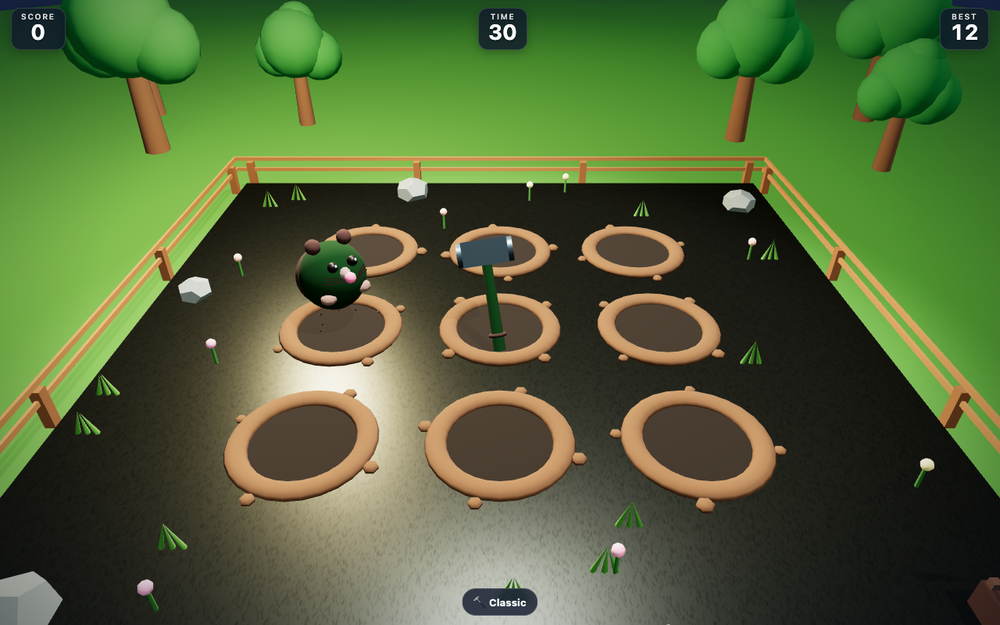

# Whack-a-Mole 3D — Mobile VR + AI Edition

[](https://whack-a-mole-eight-iota.vercel.app) [](https://threejs.org) [](index.html) [](test.cjs)

**▶ Play it now: https://whack-a-mole-eight-iota.vercel.app**

A 30-second browser arcade game built with **HTML + JavaScript + Three.js**, extended into a six-mode showcase for mobile VR and hand-written machine learning: a Cardboard-style stereo mode, a tabular Q-learning agent, a compact PPO agent with a value critic, and an imitation-learning bot that copies your play. No ML framework — every agent is plain JavaScript.

> **Keywords:** 3D whack-a-mole browser game · Three.js game · WebGL arcade game · Cardboard VR / mobile VR game in JavaScript · tabular Q-learning demo · PPO reinforcement learning from scratch · behaviour cloning / imitation learning · no build step, plays in any modern browser.



## Run it

Play the hosted build at **https://whack-a-mole-eight-iota.vercel.app**, or double-click `index.html` locally — there is no build step and no install.

- Three.js r128 and GLTFLoader load from the cdnjs CDN, so the first load needs an internet connection.
- **Optional Blender model:** drop a `mole.glb` into `assets/` and it is loaded automatically (scale-normalised). Without it the game falls back to the built-in primitive mole — no error, by design.
- **Optional test run:** `node test.cjs` drives the whole game in headless Chrome (38 end-to-end checks).
- **Pre-trained bots included:** `assets/trained.js` ships Q-learning (~2000 episodes), PPO (~2100 iterations) and imitation models exported from a training session. On first run (empty `localStorage`) the AI modes are demo-ready immediately — press **Watch bot** and they score 23–31 out of the box. Deleting it (or pressing Reset) starts every agent from scratch.
- **Retrain it yourself:** `node trainall.cjs` trains all three agents to completion in the real UI and re-exports `assets/trained.js`.

## The look

The scene is dressed like a diorama rather than a tech demo: filmic ACES tone mapping with sRGB output, a gradient sky dome, a hemisphere-light fill, procedural grass texture, deep hole pits with dirt-rim rims and clods, a wooden fence, background trees that catch long shadows, grass tufts, rocks, flowers and drifting clouds. The mole is a proper character (belly, snout, ears, whiskers, paws), the bomb is a glossy cartoon bomb with a curved fuse, and hit effects use faceted sparkle particles plus a dirt puff when a mole bursts out. A soft vignette and glassy panels frame it all.

One implementation note: with sRGB output, every authored colour is converted to linear space (`col()` helper in `scene.js`) — otherwise the whole scene renders washed-out pastel.

## The six modes

| Mode | What it is |
| --- | --- |
| 🔨 **Classic** | The arcade game: 30 s, 3×3 grid, bombs, difficulty ramp, hammer physics, particles. |
| 🥽 **Cardboard VR** | Stereo side-by-side render with an eye separation of 0.064, gyroscope head tracking on phones (drag to look on desktop), gaze to whack (hold 0.5 s — bombs are never auto-whacked). |
| 🧠 **Q-Learning** | Tabular Q-learning over the exact game state. Watch the Q-table heat map fill in, epsilon decay, and the reward curve climb; then watch the trained bot play the live scene. |
| 📈 **PPO** | A policy network (11 → 64 → 10) trained with a clipped surrogate objective and a value-head critic through GAE(λ). Editable hyperparameters (lr, batch, clip, β, λ, γ, …) update training live. |
| 🎓 **Imitation** | Record your own play, train a softmax behaviour-cloning model on your clicks, then watch the bot imitate you. |
| ℹ️ **About VR** | A VR history timeline (Sensorama 1962 → today) and application cards. |

Plus **Editor View** (live scene-graph hierarchy + inspector with position/rotation/scale/colour edits), **Code Lens** (live game variables + running method, key `L`), and **Materials & Lights** settings (four material presets per surface, per-light toggles and intensities, Day/Night presets, wireframe view — all persisted in `localStorage`).

## Controls

| Action | Mouse / keyboard | Touch |
| --- | --- | --- |
| Whack a mole | Click it | Tap it |
| Look around | Drag, or Arrow keys | Drag |
| Move the keyboard pointer | `WASD` / Arrows | — |
| Swing | `Space` | Tap |
| Cycle camera (angled / top / first-person / VR) | `C` | Camera button |
| Pause / restart / menu | `P` / `R` / `M` | Buttons |
| Editor View / Code Lens | `E` / `L` | Menu buttons |
| Gaze whack (VR mode) | Hold the centre reticle on a mole 0.5 s | Same |

## Rules

1. A round lasts 30 seconds; each mole is worth 1 point.
2. Bomb moles (18% chance) deduct a point, floor the score at 0, and explode with debris and camera shake.
3. Difficulty ramps: moles stay up for less time and spawn closer together; after 60% of the round two can be up at once.

## How the AI works (and what it honestly is)

All three agents play the **same environment** as you — a fixed-step (1/30 s) `MoleEnv` with a 10-action space (9 holes + wait) and an 11-value observation (9 hole states + time left + longest remaining stay). Rewards: +1 mole, −1 bomb, −0.05 empty hole, −0.001 per step.

- **Q-learning** keeps a table keyed by the hole-state string and updates `Q(s,a) += α(r + γ·maxQ(s′) − Q(s,a))` every step, with ε-greedy exploration and decay. It reaches near-oracle play (~30 points) within a few hundred episodes — training runs live in the browser at up to 100× speed.
- **PPO** trains a small policy network with hand-derived gradients. The honest engineering note: reward-to-go alone cannot assign credit in 900-step episodes (a hit's reward drowns across the ~100 steps before it), so the agent carries a value-head critic and uses GAE(λ) advantages — after which it converges to near-oracle play in ~2000 iterations. This mirrors why real PPO needs a critic; it is still a compact educational re-implementation, not Unity ML-Agents (which runs Python/PyTorch and cannot run in a web page).
- **Imitation** logs every successful whack you make as an `(observation → hole)` sample and fits a softmax classifier by full-batch gradient descent. It copies your style — including your mistakes.

The AI panel carries an explicit **honesty note** about this scope.

## Architecture

```
index.html          six-mode shell, panels, script loading order
css/style.css       all panel/HUD styling
js/env.js           MoleEnv — single source of truth for state, rewards, spawning
js/scene.js         Three.js scene, cameras, materials, lights, particles, glTF loader
js/game.js          GameManager, visual pool, input, hammer, effects, VR stereo render
js/agents.js        QAgent, PPOAgent (+ value critic), ImitationAgent, Trainer
js/panels.js        menu routing, settings, editor, code lens, AI panel, About VR
js/boot.js          wiring + main loop (normal vs stereo render dispatch)
test.cjs            38-check Playwright suite
```

**Unity mapping** (how the concepts translate): `MoleEnv` ≈ the game-state manager, `scene.js` ≈ scene/prefabs/materials, `game.js` ≈ `GameManager` + input + `PlayerPrefs` (localStorage), `agents.js` ≈ ML-Agents training loop, `panels.js` ≈ UI canvases, `boot.js` ≈ the bootstrap scene.

## Verified behaviour

`node test.cjs` — 38 checks, all passing in headless Chrome: boot with no errors, round start/timer, pointer hit scoring, empty-click no-op, double-hit guard, bomb deduction + score floor, game-over panel, high-score persistence, restart, resize, camera cycle, settings persistence, About VR content, editor hierarchy + live inspector edits, code lens, Q-learning training (reward −8 → +17 in 8 s), watch mode, PPO training + live hyperparameter changes, imitation training (100% accuracy) and bot play, VR stereo enter/exit, glTF fallback, Q-table autosave, phone viewport.

Screenshots: `screenshot-menu.png`, `screenshot-gameplay.png`, `screenshot-ai-q.png`, `screenshot-vr.png`, `screenshot-gameover.png`.
